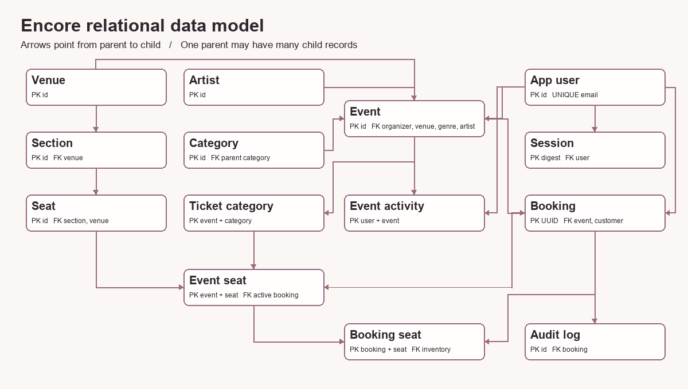

# Encore relational design

| Relation | Primary key | References and purpose |
|---|---|---|
| app_user | id | Unique lowercased email and account role |
| session | digest | User and session expiry |
| venue | id | Physical location |
| section | id | Venue, name and distance from stage |
| seat | id | Venue and section composite reference |
| artist | id | Unique artist name |
| category | id | Optional parent category |
| event | id | Venue, artist, category and organizer |
| ticket_category | event_id, name | Current category price in integer INR |
| event_seat | event_id, seat_id | Event, venue, physical seat, ticket category and optional current booking |
| booking | id (UUID) | Event, customer and reservation state |
| booking_seat | booking_id, seat_id | Immutable line price and composite references to booking and inventory |
| audit_log | id | Booking and old/new status |
| event_activity | user_id, event_id | Saved flag and last view |

Event inventory uses composite foreign keys to prevent a seat from a different venue being allocated to an event. Booking seat rows keep the unit price charged, so later changes to the event price do not alter past bookings. That price is a historical fact separate from current pricing. Venue IDs in the seat and inventory records enforce cross-table consistency.

The MongoDB preferences collection uses a unique `userId` index. A document stores genre, artist and category arrays, a total budget, a preferred section and accessibility preference. PostgreSQL identity is the lookup key. There is no cross-database transaction because preference changes and ticket allocation are independent.
